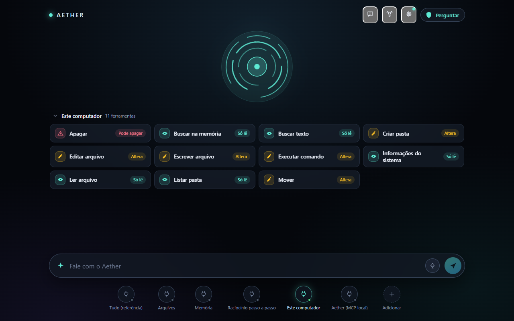
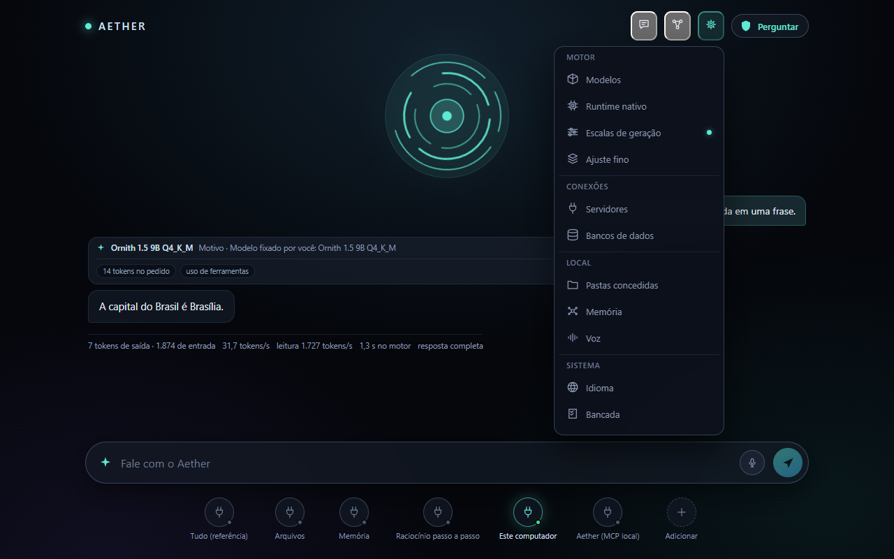
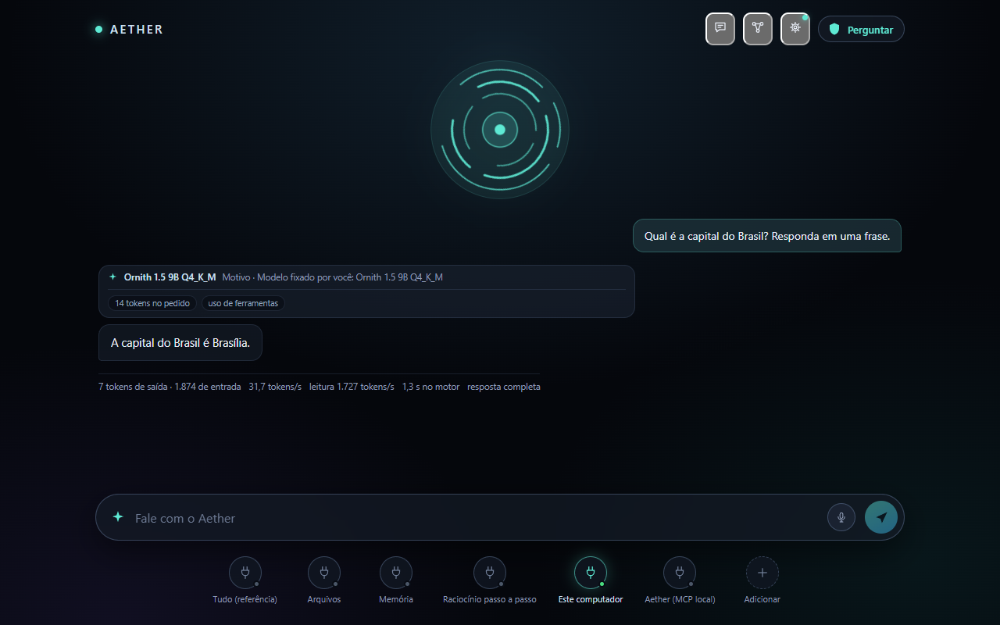
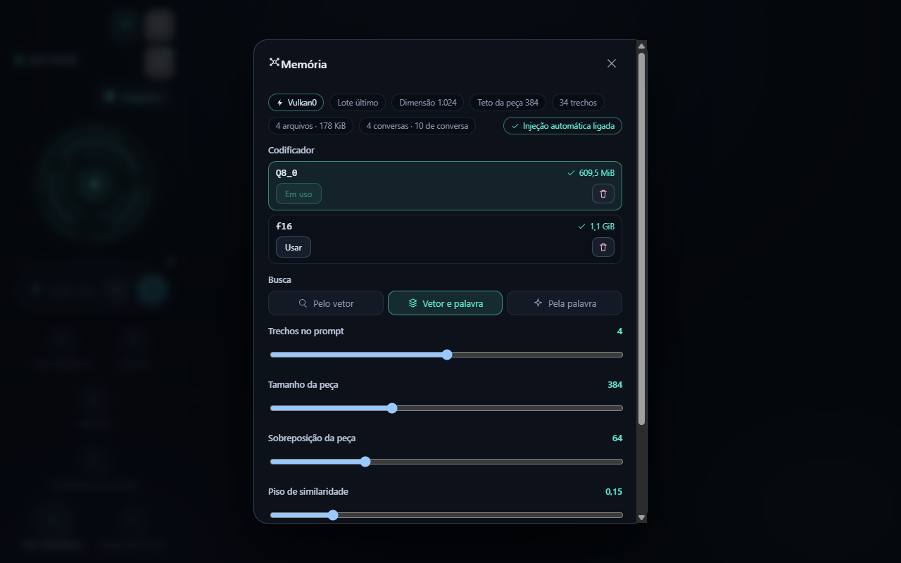
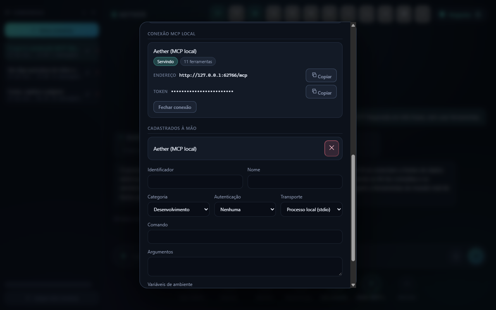
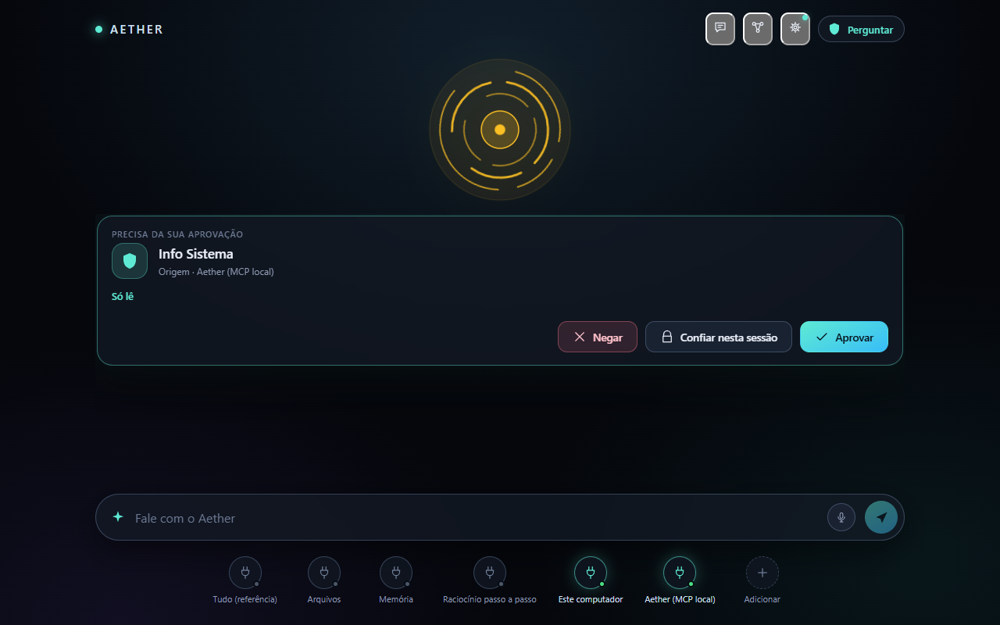
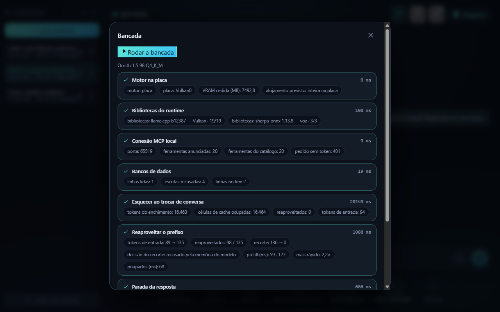

# Aether

Assistente de IA que roda inteiro no computador de quem usa. O modelo, o
tokenizador, a memória vetorial e a voz estão na máquina local; não há chamada a
serviço de terceiros em nenhum caminho de execução. O que ele faz no sistema de
arquivos e no terminal passa por um gate de permissão que a pessoa controla.

**Ele não é** um front-end para LM Studio, Ollama ou uma API de nuvem: o motor de
inferência é parte deste repositório, e o aplicativo é o dono da placa.

## A tela

As capturas abaixo são do aplicativo real rodando no Windows com a placa Vulkan,
em 18 de novembro de 2026. Nada nelas é montado: as medidas saem do motor e da
bancada.

**O núcleo** — o orbe, as ferramentas do conector embutido com o efeito de
cada uma (`Só lê`, `Altera`, `Pode apagar`) e a faixa de conectores embaixo. Na
barra ficam os controles de um turno — conversas, ligações e confiança; o resto
do aplicativo está no menu.



**O menu** — as onze telas de ajuste em quatro seções: motor, conexões, local e
sistema. O ponto verde marca a tela cujo ajuste está valendo agora.



**Um turno medido** — a resposta do Ornith 1.5 9B Q4_K_M com tokens de entrada e
saída, tokens/s de prefill e de leitura, tempo no motor e o motivo da parada.



**A memória** — a folha do índice: a placa que serve o codificador, quantos
trechos há de arquivo e quantos de conversa, e a busca de teste, que usa a mesma
régua do turno e mostra os mesmos cartões.



**A conexão MCP local** — as mesmas ferramentas do catálogo atendendo em
`http://127.0.0.1:<porta>/mcp`. A porta é sorteada a cada execução e o token
aparece mascarado na tela: ele só existe em memória e se copia, não se lê.



**A mesma conexão vista de fora** — um cliente MCP chamou `info_sistema` e o
aplicativo segurou a execução até alguém aprovar; o card diz de onde veio a
chamada (`Origem · Aether (MCP local)`) e o que o efeito dela é.



**A bancada** — a suíte que roda dentro do aplicativo. O caso `Conexão MCP
local` mede a porta sorteada, quantas ferramentas o fio anuncia contra o catálogo
que o núcleo monta nesta mesma execução (locais + bancos, contado por símbolo, não
por número escrito à mão) e o `401` de quem chega sem token.



## Como o modelo roda

| Caminho | O que executa | Quando |
| --- | --- | --- |
| GPU | llama.cpp pelo backend **Vulkan** — qualquer arquitetura que a `llama.dll` vendorizada registre | sempre que existe placa Vulkan registrada |
| CPU | implementação própria em candle (`src-tauri/src/ai/granite.rs`), só granite | máquina sem GPU, ou quando a placa recusa a carga |

Vulkan é a porta única para NVIDIA, AMD e Intel — não há SDK de fabricante no
meio. Antes de carregar qualquer modelo, `src-tauri/src/ai/alojamento.rs` lê a VRAM livre
e decide entre carga inteira na placa, camada a camada dividida com a RAM, ou só
sistema; o veredito vira `n_gpu_layers` e é conferido contra o delta real de
VRAM que a carga produz.

Os binários do llama.cpp e do sherpa-onnx não estão no repositório: são 46 MB de
pacotes de outros projetos. **O aplicativo instala o runtime sozinho** — a tela
*Runtime nativo* baixa o pacote oficial da revisão presa, confere o SHA256 de
cada arquivo contra o `SHA256SUMS.txt` versionado e só então põe tudo em
`%LOCALAPPDATA%` do aplicativo, numa pasta que o carregador procura. Nada é
movido se um hash divergir. Veja
[`src-tauri/vendor/README.md`](src-tauri/vendor/README.md).

## O que ele faz

- **Catálogo de modelos** — 35 variantes GGUF em duas famílias: Granite 4.2
  (3B e 8B, Apache-2.0) e Ornith 1.5 9B (MIT, janela de 262 mil, o modelo de
  programação), mais 2 quants do Qwen3-Embedding 0.6B. Cada tamanho é lido do
  `tree/main` do HuggingFace, arquivo por arquivo, e cada família é conferida
  contra a tabela de arquiteturas da `llama.dll` vendorizada. Download
  retomável, cancelamento e estado medido em disco. Uma conexão que cai no meio
  do corpo levanta a pedida do ponto onde parou — quatro pedidas no total, com
  1s, 2s e 4s entre elas — e o mesmo caminho serve os pesos, o runtime e a voz;
  um 404, um disco cheio ou um *Parar* devolvem o motivo na primeira conexão,
  porque retentar o que não é da rede só atrasaria a resposta certa. Um servidor
  que abre, anuncia o corpo e então silencia é cortado pelo prazo de leitura — 30
  s por leitura, não pelo corpo inteiro, então uma conexão lenta mas viva segue
  mandando peças — e esse corte entra como falha retentável na fila. O *Parar*
  responde no meio dessa espera: a cancelação corre contra a espera por bytes, não
  depois dela. Um arquivo de apoio que chegou como ponteiro Git LFS é tratado como
  ausente, não como instalado.
- **Roteador** — classifica o pedido e escolhe o modelo pela capacidade real da
  placa; a escolha é exibida com o motivo auditável e os sinais que a produziram.
  Um modelo fixado nas Escalas passa na frente do roteador. Um candidato sem ficha
  nunca afirma que cabe: vai por último na colocação e é lido como não comprovado.
  A conta de alojamento é feita com aritmética que recusa estouro, então um
  cabeçalho GGUF crafted não produz um `Inteira` falso. E quando a sonda de VRAM
  não responde, o offload total aparece com o motivo de ser total — não é
  apresentado como despacho medido normal.
- **Laço de ferramentas** — o modelo chama ferramentas MCP e locais, o gate pede
  aprovação quando a ação muda algo, e o resultado volta ao modelo. As duas
  gramáticas que aparecem na prática são lidas: o XML declarado pelo template
  que o próprio GGUF publica — é ele que o modelo viu no treino, e o
  `chat_template.jinja` do repositório de pesos pode ser outra versão — e o JSON
  em que modelos pequenos às vezes
  caem. A marca de parada é procurada no texto bruto, não no descodificado com os
  especiais ocultos: nos tokenizers que publicam o marcador de turno como token
  adicionado (Granite e Qwen) a busca antiga nunca casava, e um modelo preso
  repetindo turnos ia até o teto de tokens em vez de parar. Uma chamada cortada
  no meio pelo teto de tokens é retomada de onde o
  modelo parou, tantas vezes quantas a janela permitir — o resto do corpo é ele
  quem escreve, e o app não inventa linha;
  se ainda assim faltar um argumento obrigatório, a ferramenta recusa e diz o
  que faltou, em vez de criar um arquivo vazio com a cara de sucesso; uma
  chamada com nome que não existe devolve a lista dos nomes reais. Um pensamento
  cortado pelo teto de tokens dentro de um bloco ainda aberto devolve o motivo
  como erro, não um `Done` com texto vazio. E um JSON que aparece dentro do corpo
  de uma chamada XML já lida não vira segunda chamada: a varredura guarda os
  intervalos que a leitura XML já tomou, porque executar duas vezes a mesma
  escrita é o pior dos dois mundos.
- **Conector local** — 12 ferramentas de arquivo, terminal, código, memória e
  sistema, dentro das pastas que a pessoa concedeu, mais `criar_mcp_local`, que
  publica o servidor abaixo. Ele entra no mesmo cadastro, na mesma allowlist e no
  mesmo gate que um servidor MCP de terceiros. A contenção é lida do caminho real,
  não do texto: um symlink ou junção dentro da pasta concedida não abre porta para
  fora dela, e `mover` recusa renomear a própria raiz. Um comando que emende
  separadores do `cmd.exe` (`&`, `&&`, `|`) é tratado como composto na hora de
  decidir o efeito — o que exige aprovação não é só o primeiro programa da linha.
- **Conexão MCP local** — o agente publica as próprias ferramentas num servidor
  MCP real (Streamable HTTP) e conecta nele pelo mesmo cliente rmcp que usa para
  um servidor de terceiros. Abrir a conexão é uma decisão, não uma configuração:
  a tela de Servidores tem o botão, e a ferramenta `criar_mcp_local` faz o mesmo
  caminho. O servidor escuta em `http://127.0.0.1:<porta>/mcp` numa porta efêmera
  escolhida pelo sistema, e cobra `Authorization: Bearer <token>` — o token são 64
  caracteres hexadecimais de 32 bytes aleatórios que existem só na memória do
  aplicativo; o `mcp.json` guarda a referência `${AETHER_MCP_TOKEN}`, nunca o
  valor. A versão do protocolo é a que o `initialize` do cliente negociar; um
  cliente propondo `2026-07-28` recebeu `2025-11-25` desta build, sem id de
  sessão. Para apontar um cliente externo, abra a conexão na tela de Servidores e
  copie o endereço e o token de lá; o token muda a cada execução, assim como a
  porta. Cada chamada que entra pela porta passa pelo mesmo gate de permissões do
  laço de conversa, com o mesmo id de conector, e a recusa volta como erro de
  ferramenta — o motivo é o mesmo que o chat mostra. Medido nesta máquina com um
  cliente fora do aplicativo: sem o cabeçalho a porta respondeu `401`, com ele o
  `initialize` respondeu `200` (`serverInfo.name = aether`), `tools/list`
  devolveu o catálogo do momento (as 11 ferramentas locais, antes dos bancos
  entrarem) e um `tools/call` de `info_sistema` ficou parado até a pessoa
  clicar *Aprovar* no cartão da tela — depois disso devolveu o sistema, a placa e
  as pastas concedidas de verdade. O servidor anuncia o catálogo inteiro — as 12
  ferramentas locais e as 9 de banco de dados; `criar_mcp_local` não é anunciada
  por ele, porque publicar de dentro de uma publicação seria outra porta para a
  mesma sala. Aperto de mão e descoberta de ferramentas têm 45 s de prazo
  (`PRAZO_CONEXAO`): um servidor que inicia mas não fala devolve o erro com o id
  dele em vez de deixar a tela girando, e cair no meio é seguro nos dois
  transportes — no stdio o `Drop` da futura mata o filho. Fechar a janela
  derruba o servidor publicado e cada conector, com 5 s de teto para um servidor
  teimoso não segurar a saída.
- **Gate e o que um servidor de terceiros alega** — o efeito de uma ferramenta de
  fora é decidido pelo núcleo, não pela anotação dela. Um servidor que declara
  `read_only_hint=true` recebe o teto `Altera`: a alegação não dá para verificar,
  e uma ferramenta de escrita anotada como leitura executaria sem prompt em *Plan*
  e *Autoaceitar*. Consequência honesta: em *Plan* essa ferramenta é negada (o
  modo promete não mutar), em *Autoaceitar* roda como mutação — que o modo já
  consente — e o rótulo na tela é o conservador. As ferramentas locais e as
  leituras de banco continuam `Só lê` e continuam passando em *Plan*, porque o
  efeito delas é declarado por este repositório. E no modo *Padrão*, destrutivo
  pede aprovação mesmo depois de um "confiar neste servidor": `apagar` e
  `bancos_apagar` não entram pela porta do grant de sessão, que era o caminho que
  deixava o modo cauteloso menos seguro que o modo aberto.
- **Bancos de dados** — conexões com SQLite, PostgreSQL, MySQL, SQL Server,
  MongoDB e Oracle cadastradas na tela *Bancos de dados* (o Oracle fala o
  protocolo do driver oficial em modo thin, sem Instant Client instalado). A
  política é por tabela: ler, inserir, atualizar e apagar, um toggle para cada,
  e toda conexão nova nasce só de leitura. O cadastro é relido do disco a cada
  chamada — o gate aprova o ato, o cadastro aprova o alvo: o que não está
  exposto o modelo nem descreve, e a escrita sem permissão é recusada antes de o
  motor abrir. O alvo é lido como valor, nunca como operador: um filtro com chave
  começando com `$` não vira operador do Mongo, e uma coluna só aparece no
  catálogo se a tabela dela tem permissão de leitura. O teto de linhas por
  leitura e o SQL livre são da conexão. São 9
  ferramentas (`bancos_listar` a `bancos_sql`) no mesmo catálogo, na mesma
  allowlist e no mesmo gate que as locais; só `bancos_apagar` é destrutiva.
- **Memória (RAG)** — um índice, duas fontes: os arquivos das pastas concedidas e
  as conversas salvas. As duas entram na mesma busca híbrida (BM25 + vetorial com
  fusão), com peças sobrepostas e piso de similaridade, e cada uma obedece à
  política da própria fonte: um trecho de arquivo só é lembrado enquanto a pasta
  dele continua concedida; um trecho de conversa é lembrado enquanto a conversa
  está no histórico e não é a conversa em curso, que já está na janela do modelo.
  Revogar uma pasta não apaga a memória de conversa e a varredura de pastas não
  apaga as conversas. A injeção automática e a ferramenta `buscar_memoria`
  obedecem ao mesmo fio do grafo; a ferramenta, ao contrário da injeção, também
  responde pela conversa aberta. O bloco que entra no turno declara de quem é
  cada linha — `você:` é o que o usuário escreveu, `Aether:` é a resposta dele —
  e o cartão cita a conversa e o número da fala, então aquelas falas não são
  lidas como texto de arquivo. O índice guarda por conversa a prova do estado
  dela (contagem de mensagens e instante da última), então um turno sem histórico
  novo não custa um vetor. O trabalho de conversa paga um teto de tokens por turno
  (8.192) e sempre entrega ao menos uma conversa inteira; a varredura, que corre
  fora do turno com barra de progresso, drena o resto — e não congela a tela: o
  estado que a janela lê vem de um espelho pequeno, não do lock que a varredura
  segura arquivo por arquivo. Os escritores do índice fora da varredura (revogar
  uma pasta e revalidar as conversas de um turno) são serializados: sem isso, dois
  leem a mesma cópia e o último publica ressuscita o trecho que o primeiro acabou
  de apagar, no disco e na memória. Medido na suíte: 509 testes de unidade
  passando, 516 no total com os 7 que pedem rede ou placa, incluindo os que provam
  o isolamento das duas fontes, a idempotência da prova e os que soltam dois
  escritores no mesmo índice por uma barreira e exigem zero efeitos perdidos.
- **Voz** — Kokoro para fala, Whisper para escuta, ambos locais.
- **Conversas salvas** — várias conversas no disco, com barra lateral: criar,
  trocar, renomear e apagar (com confirmação em dois cliques). Trocar de conversa
  esquece o KV: a conversa seguinte não herda o estado da anterior. Trocar no meio
  de um turno também não congela mais a tela: os comandos de conversa não esperam
  o motor; quando ele está ocupado, a recusa diz isso em vez de travar a janela
  até a geração acabar. O índice e as
  mensagens ficam em `%APPDATA%\ai.aether.core\conversas` e voltam onde estavam
  depois de fechar e abrir o aplicativo. O índice é um resumo, não a fonte: os
  arquivos de cada conversa são a fonte, então um `indice.json` corrompido refaz a
  lista do disco em vez de abrir o aplicativo com o histórico vazio. E um lock só
  cobre o arquivo da conversa e o índice juntos: renomear durante um save de turno
  no mesmo id era os dois lendo o mesmo estado, com o último a escrever apagando o
  título escrito à mão — ou as mensagens do turno.
  O que foi dito nelas entra na memória: a
  transcrição de cada conversa (só as falas, sem as chamadas de ferramenta) vira
  índice, com o título e a data no cartão de onde o trecho saiu.
- **Bancada** — uma suíte de nove casos que roda dentro do aplicativo e mede
  cada um: motor na placa, bibliotecas do runtime, conexão MCP local, bancos de
  dados (com política só de leitura e um SQLite real montado na hora), esquecimento
  do KV entre conversas, reaproveitamento do prefixo, parada da resposta, texto
  em fluxo e compactação da conversa longa. Os três casos sem modelo — runtime,
  MCP local e bancos — rodam sem carregar pesos. Cada caso traz suas medidas e
  um veredito
  aprovado/reprovado; nenhum caso é aprovado por suposição — ele aprova o que o
  motor devolveu naquela rodada. A bancada não começa com um turno de conversa em
  curso, e o botão *Parar* dela usa o mesmo interruptor de cancelamento do chat.
- **Grafo** — a tela de ligações é a forma de editar a política (quais
  conectores, quais ferramentas, quais pastas). O desenho não é a política: o
  núcleo cobra `mcp.json` e `pastas.json` em cada chamada.
- **Eficiência do KV** — o prompt de uma rodada de ferramenta é o da anterior mais
  o resultado dela, e o cache só precisa continuar de onde o histórico muda. A
  placa recorta as células depois da divergência (`llama_memory_seq_rm`, com a
  recusa da memória tratada como medida, não como erro) e prefila o resto. Medido
  na bancada, no mesmo aplicativo: 113 de 153 tokens de entrada reaproveitados,
  prefill de 30 ms contra 67 ms com o cache esquecido. Numa conversa real, o
  turno mostrou 2.034 dos 2.467 tokens de entrada já calculados — 433 tokens
  novos.
- **Compactação** — o turno que não cabe na janela deixa de ser recusa: o próprio
  modelo resume os turnos mais antigos, dentro de uma reserva de até 320 tokens, e
  a resposta continua com o resumo no lugar do texto velho. Medido nesta máquina,
  na mesma conversa: com a janela em 4.096 o pedido entrou com 7 mensagens
  dobradas em um resumo escrito pelo modelo (108 tokens de saída, 4.443 de
  entrada, 5,4 s no motor) e a resposta veio; com a janela em 65.536 a mesma
  conversa coube inteira e o turno custou 4.324 tokens de entrada, 2,2 s, sem
  dobra nenhuma. O caso da bancada que mede isso aprovou com janela 4.096, limite
  de prompt 3.840, 1 dobra e 55 tokens gerados (2.891 ms) — e reprova, com os
  números do banner antigo, se a decisão de dobrar volta a ser recusa.
- **Janela de resultado** — o corpo de uma ferramenta é o que pesa: um
  `ler_arquivo` devolve até 256 KiB, um comando até 64 KiB, e cada rodada seguinte
  prefila aquilo de novo para o modelo chegar à chamada seguinte. Acima de 4.096
  caracteres o corpo sai do histórico e vira um arquivo do depósito; ao modelo
  vão os 1.536 primeiros caracteres, os 512 últimos e um id. A 12ª ferramenta do
  catálogo, `ler_resultado`, devolve o pedaço que ele pedir — até 3.584 por
  chamada, e o teto é essa conta e não o limiar porque o cabeçalho vai na frente:
  uma leitura do tamanho exato do limiar seria um resultado longo, derramado de
  novo, e o laço passaria a guardar janelas de janelas. O que a pessoa vê não
  encolhe: o cartão continua recebendo o resultado inteiro, e um erro de
  ferramenta nunca é cortado. O depósito guarda os 64 resultados mais novos; um id
  que já saiu de lá responde com a lista dos que estão, como o nome errado de uma
  ferramenta responde com a lista dos nomes reais.
- **Medidas visíveis** — tokens de entrada e saída, quantos deles vieram do cache,
  tokens/s de prefill e decode, tempo no motor, motivo de parada, quantas
  mensagens entraram no resumo daquela resposta e quantas ficaram de fora dele
  (couberam no corte, não coube na régua do resumo — o número aparece em aviso
  quando é maior que zero, porque dizer que dobrou dez e ter lido três seria o
  aplicativo garantindo uma memória que o modelo não teve).
- **Runtime nativo** — as DLLs de que o motor e a voz dependem não são um passo
  manual: o aplicativo baixa o pacote oficial (llama.cpp b12387 Vulkan, 38.119.681
  bytes; sherpa-onnx 1.13.8, 8.032.957 bytes), confere arquivo por arquivo contra
  as somas versionadas e instala na pasta de dados. A tela mostra o que falta em
  cada pasta procurada, o progresso real do download e o veredito de cada hash —
  medido e esperado lado a lado. Um pacote incompleto acende uma faixa na janela
  principal, porque num PC novo era exatamente aí que o download dos pesos
  terminava e a inferência não abria.

Todo texto da interface vem de `locales/pt-BR.json` e `locales/en-US.json`, e um
teste de suíte exige que as duas línguas tenham exatamente as mesmas chaves e os
mesmos placeholders.

## Rodar

Pré-requisitos: Windows 10+, Rust (stable), Node 20+ e WebView2 Runtime. As DLLs
vendorizadas (link acima) não são pré-requisito para compilar nem para rodar: sem
elas o build avisa e segue, e o aplicativo as instala pela tela *Runtime nativo*.
Colocá-las em `src-tauri/vendor/*/lib/` antes de empacotar ainda é o que faz o
instalador levá-las — aí o usuário não baixa nada na primeira execução.

```sh
npm install
npm run tauri dev
```

A janela de desenvolvimento serve a interface em `http://localhost:5173` (Vite).
Para o pacote:

```sh
npm run build
npm run tauri build
```

## Testar

```sh
cd src-tauri && cargo test --lib     # 516 testes (509 passam, 7 com `#[ignore]`)
npm run build                        # tsc + vite
```

Os testes que dependem de rede real (download do HuggingFace) e os que dependem
de placa estão marcados com `#[ignore]` e rodam sob demanda:

```sh
cd src-tauri && cargo test --lib -- --ignored
```

Uma sonda separada carrega pesos reais e mede o motor:

```sh
cd src-tauri && cargo run --bin engine-probe -- <pasta-do-modelo> <arquivo.gguf> [contexto] [max_tokens] [prompt]
```

O mesmo conjunto de verificações, feito dentro do aplicativo e contra o modelo
carregado, é a tela **Bancada** — nove casos, um veredito medido por caso.

## Estrutura

```
src/                 interface React + TypeScript
  components/        conversa, barra de conversas, catálogo de modelos, conectores,
                     grafo, memória, voz, bancada
src-tauri/src/       núcleo Rust
  ai/                motor, catálogo, download, alojamento, roteador, sessão, memória
  bancada.rs         os nove casos medidos dentro do aplicativo
  bancos/            cadastro de conexões, os seis motores de banco de dados
                     e as 9 ferramentas, com a política por tabela
  mcp/               cliente MCP, catálogo instalável, gate de aprovação e o
                     servidor que publica as ferramentas do próprio Aether
  local/             ferramentas locais e contenção de pastas
  voz/               fala (Kokoro) e escuta (Whisper)
docs/capturas/       as imagens desta página
docs/melhorias/      o registro medido das frentes de auditoria: o que foi
                     encontrado, o que virou correção, com o teste que falava
                     antes de cada uma
locales/             pt-BR e en-US, a única fonte de texto do produto
src-tauri/vendor/    cabeçalhos, licenças e somas dos binários de terceiros
```

## Estado em disco

O aplicativo grava em `%APPDATA%\ai.aether.core` (ajustes, conectores,
allowlists, pastas concedidas, grafo, voz, RAG e o cadastro de bancos de dados),
em `%APPDATA%\ai.aether.core\conversas` (o índice e as mensagens de cada
conversa), em `%LOCALAPPDATA%\ai.aether.core\models` (pesos, índice e os pacotes
de runtime instalados) e em `%LOCALAPPDATA%\ai.aether.core\resultados` (os corpos
de ferramenta que saíram do histórico para caber na janela — texto cru do que a
ferramenta leu, dos 64 mais novos, sem cifra nenhuma). Nenhum desses arquivos sai
da máquina.

Segredo não vai para disco: o `mcp.json` guarda no máximo a referência
`${AETHER_MCP_TOKEN}`, e o valor dela vive só na memória do aplicativo enquanto a
conexão MCP local está aberta. Fechar o aplicativo, ou o botão da tela, esquece o
token; reabrir a conexão gera outro. O `bancos.json` segue a mesma regra por
outro caminho: a senha de cada conexão é cifrada pelo DPAPI do Windows no escopo
do usuário — a cifra não abre em outra máquina nem em outro usuário — e o valor
real só existe na memória do aplicativo, na hora de abrir a conexão.

## Limites conhecidos

- A integridade de um download é conferida por tamanho, não por hash: o arquivo é
  publicado quando os bytes recebidos batem com o que o servidor anuncia. Um
  corpo corrompido no meio, com o tamanho certo, passaria. Conferir o sha256 que o
  HuggingFace publica, antes do rename, é o próximo passo — registrado em
  `docs/melhorias/PLANO.md`.
- O modelo que o roteador escolhe para uma tarefa média tem 3 bilhões de
  parâmetros. Ele às vezes traduz o nome de uma ferramenta ao chamá-la, e o
  repositório não finge que isso é confiabilidade: o erro devolve os nomes reais
  e o laço para quando o modelo insiste, em vez de queimar a placa. Para
  programação existe o Ornith 1.5 9B no gerenciador de modelos — ele não vem
  instalado, são 5,4 GiB de pesos, e o roteador só o escolhe depois de baixado.
- O caminho de CPU executa só granite, porque é uma implementação própria em
  candle. Numa máquina sem GPU, as outras famílias do catálogo não carregam, e o
  aplicativo diz qual arquitetura pediu o quê em vez de falhar mudo.
- Recortar o KV no meio do histórico depende do tipo de memória do modelo. Num
  híbrido com estado recorrente — o Ornith 1.5 9B é um — a metade recorrente só
  desfaz dentro dos instantâneos do último lote, e `llama_memory_seq_rm` devolve
  `false` para um recorte no meio (medido na bancada: 136 células → recusa → 0
  reaproveitados). Nesses modelos a rodada divergente prefila inteira, como faz o
  llama.cpp; o reaproveitamento do prefixo puro continua valendo. Num modelo de
  atenção pura (Granite 4.2 3B) o recorte acontece e é medido.
- Adaptadores LoRA/QLoRA por turno estão em construção; o que existe hoje é o
  catálogo GGUF, o roteador e a montagem de contexto.
- Janela e teto de tokens são escalas do usuário. A escada de janela vai até o
  `context_length` que o GGUF instalado publica no próprio cabeçalho (262.144 no
  Ornith 1.5 9B, 131.072 no Granite 4.2 3B). As Escalas também mostram, medido na
  última carga, a maior janela que ainda vai inteira na placa — 65.536 aqui, com
  16.195.903.344 bytes livres na Vulkan0 no momento da leitura — e um botão leva a
  escala para esse número. Acima do que a placa leva o alojamento passa a
  *dividida* e a tela diz quantas camadas ficaram na placa; o pedido continua
  autorizado, porque a janela maior é escala do usuário, não do motor. O resumo é
  a última saída: se nem com a conversa dobrada o prompt fixo e o pedido cabem, o
  aplicativo diz quantos tokens são cada um, em vez de cortar em silêncio.

## Licença e contribuições

Apache-2.0 — veja [LICENSE](LICENSE). Para mexer no código, leia
[CONTRIBUTING.md](CONTRIBUTING.md); os binários vendorizados têm suas próprias
licenças em `src-tauri/vendor/`.
